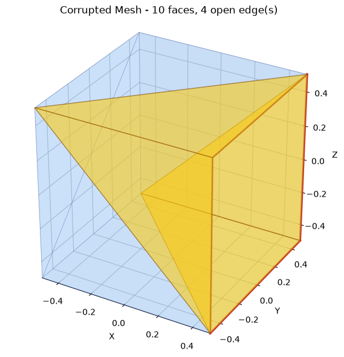
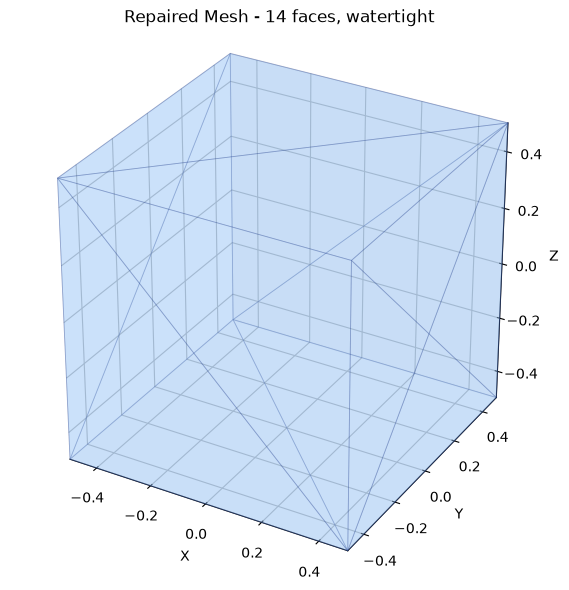

# STL File Repair

A small Python tool that finds holes (open edges) in an STL mesh, visualises them in 3D, patches them with new faces and exports the result.


[](https://github.com/VamsiKrishnaThota03/stl-file-repair/actions/workflows/ci.yml)
[](https://github.com/VamsiKrishnaThota03/stl-file-repair/actions/workflows/codeql.yml)
[](LICENSE)

## Overview

STL files exported from CAD tools or scanners are often not watertight: some triangle edges belong to only one face, leaving gaps in the surface. This project loads an STL file with [`trimesh`](https://trimesh.org/), detects those open edges, highlights them in a Matplotlib 3D view, closes each hole with a triangle fan, re-orients normals and saves a repaired copy.

| Before | After |
|---|---|
|  |  |

A helper script is included to generate a valid test cube and a deliberately corrupted copy of it.

## Features

- **Command line or file picker**: pass the `.stl` path as an argument, or run without one to choose it in a Tkinter dialog
- **Open-edge detection**: counts how many faces use each edge; edges used exactly once are reported as open
- **Hole detection**: open edges are chained into boundary loops, following the winding of the faces around them
- **Hole filling**: each loop is closed with a fan of triangles around a new vertex at the loop's centre (a triangular hole gets a single face), with winding that matches the rest of the mesh. `trimesh`'s `fix_normals()` is then applied.
- **3D visualisation**: Matplotlib views of the mesh before and after repair, with open edges in red and the faces next to them in yellow. Close the window to continue, use `--no-view` to skip it, or `--plot-dir` to save the views as PNG files.
- **Export**: writes the repaired mesh (default `repaired_cube.stl`, change with `-o`)
- **Test data generator**: `generate_corrupt.py` writes a unit cube (`valid_cube.stl`) and a copy with one to three sides removed (`corrupted_cube.stl`), or with random bytes changed (`--random-bytes`)
- **Tests** for detection, filling and the CLI (`test_repair.py`)

## Tech stack

- Python 3.9+
- [trimesh](https://github.com/mikedh/trimesh): mesh loading, normal fixing and export
- NumPy: face array manipulation
- SciPy: needed by `trimesh` for `fix_normals()`
- Matplotlib (`mplot3d`): 3D visualisation
- Tkinter: file selection dialog (ships with most Python installs)

## Project structure

```
stl-file-repair/
├── repair_stl.py            # Main tool: detect, visualise, repair and export
├── generate_corrupt.py      # Builds a valid cube STL and a copy with holes
├── test_repair.py           # unittest suite
├── requirements.txt
├── valid_cube.stl           # Sample: watertight unit cube
├── corrupted_stl_file.stl   # Sample: small ASCII mesh with open edges ("cube_with_hole")
└── docs/screenshots/        # Before/after plots used in this README
```

## Getting started

### Prerequisites

- Python 3.9 or later
- A desktop environment only if you want the file dialog or interactive plot windows (`--no-view` works headless)

### Install

```bash
git clone https://github.com/VamsiKrishnaThota03/stl-file-repair.git
cd stl-file-repair

python -m venv .venv
source .venv/bin/activate        # Windows: .venv\Scripts\activate
pip install -r requirements.txt
```

### Run

```bash
python repair_stl.py corrupted_stl_file.stl                 # shows before/after plots, writes repaired_cube.stl
python repair_stl.py corrupted_stl_file.stl -o fixed.stl --no-view
python repair_stl.py my_part.stl --no-view --plot-dir plots  # save before.png / after.png instead
python repair_stl.py                                        # pick a file in a dialog
```

The terminal reports the number of open edges, how many holes were closed and whether the result is watertight. If the mesh is already watertight, the tool says so and exits without writing a file. The exit code is non-zero if the file can't be loaded or saved.

### Generate test files

```bash
python generate_corrupt.py                    # valid_cube.stl + corrupted_cube.stl (one side missing)
python generate_corrupt.py --holes 3          # three adjacent sides missing
python generate_corrupt.py --random-bytes 0.01 --seed 1   # random byte damage instead
```

### Tests

```bash
python -m unittest -v
```

## Known limitations

- Each hole is filled with a flat-ish fan around its centre. That is exact for planar holes (like a missing cube side) but only approximate for large or strongly curved holes, which come out as a "tent".
- Damage that produces non-manifold edges (an edge shared by three or more faces) or self-intersections isn't fixed; random byte corruption often leaves a few open edges for that reason.
- The Matplotlib viewer is meant for small meshes; very large models will be slow to draw.

## Contact

Thota Vamsi Krishna — [GitHub](https://github.com/VamsiKrishnaThota03)


## Reproducibility

`requirements.txt` previously used `>=` ranges, so a fresh install could pick up
a new major release and change behaviour with no commit here. Both of the
obvious candidates matter for this tool: trimesh 5 changed mesh-processing
defaults, and numpy 2 changed several dtype-promotion rules. The versions are
now pinned, and Dependabot opens the upgrade PRs so bumps are deliberate.

## Tests and CI

```bash
MPLBACKEND=Agg python -m unittest -v     # 6 tests
```

The 6 unit tests cover single and adjacent holes, a triangular hole needing one
face, a watertight mesh being left alone, and a missing file.

CI adds four end-to-end checks against the bundled fixtures, because the unit
tests work on in-memory meshes and never exercise the CLI:

| Check | Why it is written this way |
| --- | --- |
| Repairs the corrupt mesh | Asserting the CLI exits 0 and writes a file would pass even if nothing was fixed. `scripts/verify_repair.py` loads both meshes and requires the input to start non-watertight, the output to end watertight, and faces to have been added — it also fails loudly if the fixture itself has drifted to watertight, which would make the check vacuous |
| A watertight mesh is not rewritten | The CLI deliberately skips writing when there is nothing to fix, so an output file appearing here would mean it modified a mesh it should have left alone |
| Plots render headlessly | `--plot-dir` with `MPLBACKEND=Agg`, confirming both PNGs are produced without a display |
| A missing input fails cleanly | Non-zero exit without a traceback |

CodeQL runs over Python weekly; Dependabot watches pip and Actions.
